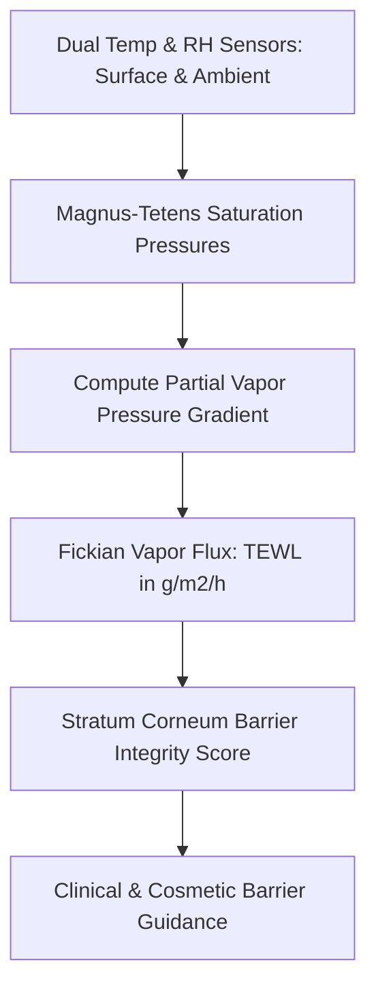

# Cutaneous Transepidermal Water Loss (TEWL) Skill

[](LICENSE)
[](https://www.python.org/)
[](https://openclaw.org/)
[](https://alphapark.ai/)
[](https://modelcontextprotocol.io/)

Cutaneous Transepidermal Water Loss (TEWL) and Stratum Corneum Barrier Integrity Analyzer based on Fick's first law of diffusion.



## Features
- **Zero PIP Dependencies**: Implemented strictly with Python Standard Library (`math`, `json`, `sys`, `typing`).
- **Physical Diffusion Laws**: Magnus-Tetens formula and Fick's first law of steady-state diffusion.
- **Micro-Climate Sensitivity**: Compensates for sensor geometry and ambient conditions.
- **Dual Architecture**: Native Python import and Model Context Protocol (MCP) JSON-RPC 2.0 stdio server.

## Quickstart
```bash
python example_usage.py
```

## License
Apache-2.0
